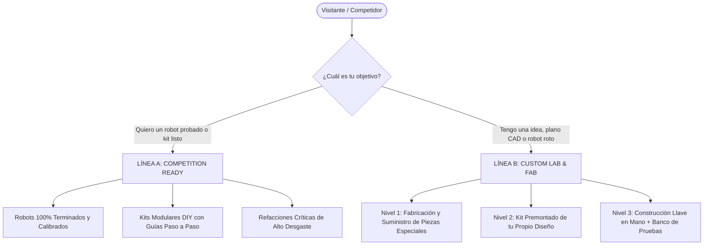
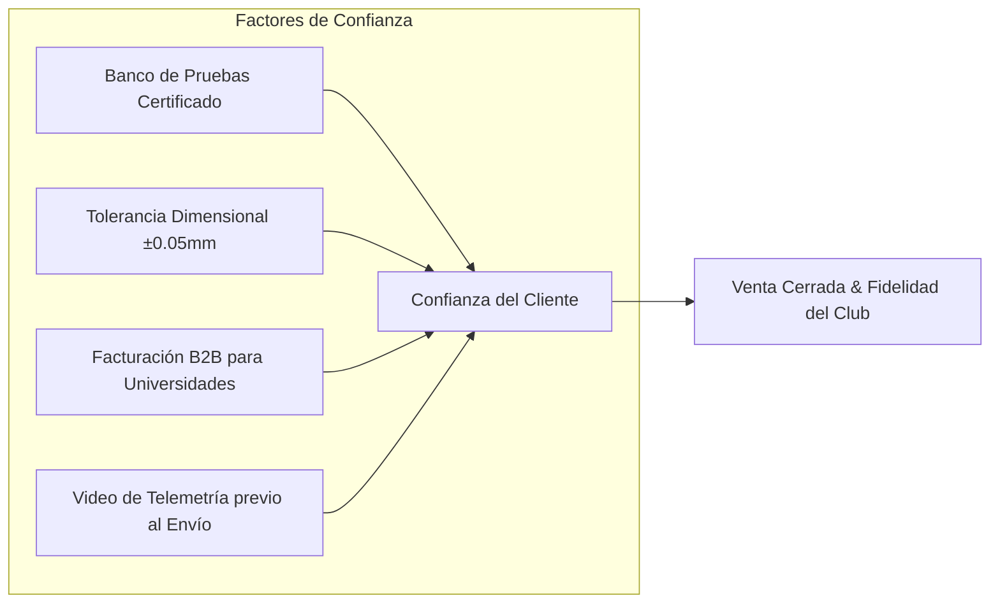

# 🛠️ Propuesta Integral & Walkthrough: Plataforma Web de Robótica de Competición
**Nombre Clave del Proyecto:** *ApexRobotics Lab / MechVector Engineering*  
**Documento:** Arquitectura de Experiencia de Usuario (UX), Dirección Visual e Innovación Funcional  
**Autor:** Antigravity Engineering & Design Team  

---

## 📑 Índice de Contenidos
1. [Diagnóstico y Filosofía de Diseño: Alta Tecnología sin Clichés](#1-diagnóstico-y-filosofía-de-diseño-alta-tecnología-sin-clichés)
2. [Complemento a tu Propuesta: El Modelo de Doble Motor](#2-complemento-a-tu-propuesta-el-modelo-de-doble-motor)
3. [Las 5 Funciones "Killer" (Innovación y Alta Utilidad)](#3-las-5-funciones-killer-innovación-y-alta-utilidad)
4. [Arquitectura de Información y Flujo de Usuario](#4-arquitectura-de-información-y-flujo-de-usuario)
5. [Walkthrough Pantalla por Pantalla (Recorrido de la Experiencia)](#5-walkthrough-pantalla-por-pantalla-recorrido-de-la-experiencia)
   - [5.1. Hero Section & Home: Autoridad Mecatrónica Inmediata](#51-hero-section--home-autoridad-mecatrónica-inmediata)
   - [5.2. Catálogo de Competición: Selector por Reglas y Clases](#52-catálogo-de-competición-selector-por-reglas-y-clases)
   - [5.3. El Despiece Interactivo (Exploded View Configurator)](#53-el-despiece-interactivo-exploded-view-configurator)
   - [5.4. El Portal "Custom Lab": Envía tu Diseño / Robot](#54-el-portal-custom-lab-envía-tu-diseño--robot)
   - [5.5. Suite de Ingeniería para Equipos y Estudiantes](#55-suite-de-ingeniería-para-equipos-y-estudiantes)
6. [Estrategia de Confianza, Validación y B2B Educativo](#6-estrategia-de-confianza-validación-y-b2b-educativo)
7. [Stack Tecnológico Recomendado & Hoja de Ruta](#7-stack-tecnológico-recomendado--hoja-de-ruta)

---

## 1. Diagnóstico y Filosofía de Diseño: Alta Tecnología sin Clichés

### 🚫 Qué vamos a erradicar:
* **Cero luces de neón púrpuras/cyan estilo *cyberpunk*:** Suelen dar sensación de producto "juguete", "gamer casual" o plantilla genérica.
* **Cero fondos negros con rejillas luminosas de baja fidelidad:** Restan seriedad y cansan la vista.
* **Cero renders falsos de ciencia ficción:** No queremos robots humanoides con ojos láser que no existen en una competencia real.

### 🎯 La Estética Propuesta: "Industrial Motorsport & Aerospace Precision"
La robótica de competencia (Sumo, Combate de 1lb/3lb, Micromouse, Seguidores de turbina) no es ciencia ficción: **es automovilismo e ingeniería aeroespacial a escala milimétrica**. El diseño web debe inspirarse en marcas de ingeniería de alto rendimiento como *Haas F1, Boston Dynamics, Festo, Teenage Engineering, Voron Design* y *Markforged*.

```
+-----------------------------------------------------------------------------------+
|  PALETA CROMÁTICA TÉCNICA                                                         |
+-----------------------------------------------------------------------------------+
|  [ #0D1117 ] Grafito Aeroespacial Profundo (Fondo principal / contraste mate)     |
|  [ #161B22 ] Titanio Arenado (Tarjetas técnicas, paneles de instrumentación)      |
|  [ #2A3342 ] Acero Mecanizado (Bordes milimétricos y separadores estructurales)  |
|  [ #F0F6FC ] Blanco Tiza Puro (Tipografía de alta legibilidad y jerarquía)        |
|  [ #8B949E ] Gris Calibre (Metadatos, unidades de medida y especificaciones)     |
|  [ #FF5A1F ] Naranja Industrial de Seguridad (Call To Action, torque y potencia)  |
|  [ #0284C7 ] Azul Cobalto Anodizado (Modo inspección técnica / CNC / precisión)  |
+-----------------------------------------------------------------------------------+
```

### Elementos visuales clave:
* **Micro-indicadores y cotas milimétricas:** Etiquetas técnicas en tipografía monoespaciada (ej. `CLASS: MINI-SUMO 500G | MAX-TORQUE: 2.8 Nm | TOLERANCE: ±0.05mm`).
* **Fotografía y texturas de materiales reales:** Fibra de carbono tejida en mate, aluminio 7075 anodizado, pistas de PCB en negro mate (negro/oro ENIG), silicón de tracción vulcanizado y titanio Grado 5 con marcas de mecanizado CNC reales.
* **Esquemas técnicos / Blueprints limpios:** Diagramas vectoriales de despiece y vistas ortogonales (planta, alzado, perfil) con cotas interactivas.

---

## 2. Complemento a tu Propuesta: El Modelo de Doble Motor

Tu propuesta central tiene dos grandes vertientes que deben convivir de forma intuitiva sin canibalizarse:



### ¿Cómo complementamos tu idea para hacerla un negocio imbatible?
1. **No solo "vender piezas", sino ofrecer "Validación de Diseño previa a la fabricación":**
   Cuando un usuario suba su diseño o robot, el sistema no solo recibe el archivo; le ofrece un análisis preliminar de viabilidad (evitando que gaste dinero en piezas que van a colisionar mecánicamente o sobrecargar los drivers).
2. **Servicio de Diagnóstico & Optimización ("Pit Stop"):**
   Muchos competidores tienen robots que fallaron en su último torneo. Abrimos la opción de "Envíanos tu robot dañado/descalibrado para tunearlo, cambiar tracción y aligerarlo para la báscula oficial".
3. **Paquetes para Clubes y Escuelas:**
   Facilidades para generar cotizaciones instantáneas con desglose de impuestos, formato PDF formal y cartas técnicas listas para someter a aprobación de presupuestos universitarios o de patrocinadores.

---

## 3. Las 5 Funciones "Killer" (Innovación y Alta Utilidad)

Para que la página sea catalogada como **la referencia tecnológica del rubro**, incorporamos herramientas interactivas que ningún competidor genérico de e-commerce posee:

### ⚡ 1. "Rulebook & Weight-Class Compliance Checker" (Inspector de Homologación)
* **El Problema:** La mayor pesadilla de un competidor es llegar a la báscula de pesaje y dimensiones del torneo y ser **descalificado** por 5 gramos o 2 milímetros de exceso.
* **La Solución en la Web:**
  * El usuario selecciona la liga o reglamento (ej. *All Japan Robot-Sumo*, *RoboCore*, *RoboGames*, *Torneo Nacional Escolar*, *RoboChallenge Europa*).
  * Selecciona la categoría: Mini-Sumo (500g, 10x10cm), Beetleweight Combate (3lb / 1360g), Seguidor de Línea (peso libre, dimensiones de pista).
  * El usuario o el carrito valida automáticamente: peso estimado de componentes, dimensiones y voltaje permitido.
  * Si el robot que está armando cumple al 100%, emite el sello: `PASSED: 100% COMPATIBLE CON REGLAMENTO ROBOGAMES 2026`.

### 🔍 2. "Exploded-View 3D Configurator" (Despiece 3D Interactivo)
* **La Experiencia:**
  * En lugar de fotos estáticas de un robot cerrado, el cliente tiene un control deslizante o botón `[ EXPLORAR DESPIECE ]`.
  * El robot se separa en 3D en sus capas fundamentales:
    1. **Pala frontal / Escudo de impacto** (Hardox / Titanio / Acero templado)
    2. **Chasis estructural** (Nylon-CF / Aluminio 7075 mecanizado)
    3. **Electrónica de potencia** (ESC dual de 50A, microcontrolador STM32/ESP32-S3)
    4. **Tren motriz** (Motores coreless/brushless de alto torque, reductores planetarios metálicos)
    5. **Tracción** (Rines de aluminio torneado con uretano colado al vacío)
  * Al hacer clic en cualquier componente del despiece, el usuario puede cambiar la pieza (ej. cambiar motor estándar de 50:1 por versión premium Maxon 30:1) y ver la variación en vivo de: **Precio final, Peso acumulado y Velocidad pico teórica**.

### 📐 3. "The Custom Lab": Visor y Cotizador CAD en Navegador (Three.js / WebGL)
* **La Experiencia:**
  * El cliente arrastra su archivo `.STEP`, `.STL` o paquete de fabricación.
  * El visor web renderiza la geometría 3D en tiempo real con sombreado de alambre técnico (wireframe industrial).
  * El usuario selecciona el nivel de asistencia requerida mediante botones de selección rápida:
    * `[ ] Solo maquila de piezas (Corte Láser CNC, Impresión 3D FDM grado ingeniería, Torneado)`
    * `[ ] Maquila de piezas + Suministro de componentes electrónicos compatibles`
    * `[ ] Montaje completo + Soldadura de PCB + Cableado ignífugo`
    * `[ ] Llave en mano: Construcción + Calibración de firmware PID + Test de telemetría grabado en video`
  * El sistema genera una estimación de presupuesto preliminar con desglose transparente de materiales y mano de obra de laboratorio.

### 📊 4. Calculadora de Cinemática y Tracción para Dohyo y Pista
* **Herramienta gratuita para la comunidad (Generador de tráfico masivo):**
  * Parámetros de entrada: Radio de llanta, RPM del motor a voltaje nominal, reducción del engranaje, peso del robot y material de la pista (acero pintado, madera, tatami de lona).
  * Salida instantánea:
    * Velocidad máxima teórica ($m/s$).
    * Aceleración de 0 a 100 cm.
    * Fuerza de empuje estática (Crítico para ganar en Sumo) y punto de bloqueo por torque (*Stall Current*).
  * Debajo del cálculo aparece el botón: `[ CONFIGURAR ROBOT CON ESTOS PARÁMETROS ]`.

### 🏆 5. "Arena Verified / Hall of Fame" (Salón de la Fama y Telemetría Real)
* **Generador de Confianza Absoluta:**
  * Fichas de robots construidos por la empresa o construidos por clientes con kits del sitio.
  * Medallas obtenidas, récord de victorias, tiempo de vuelta en pistas oficiales (ej. *"Circuito de 24m completado en 3.84 segundos con turbina de vacío al 85%"*).
  * Acceso libre a la telemetría y a los esquemas de pines de conexión para clientes registrados.

---

## 4. Arquitectura de Información y Flujo de Usuario

```
[ BARRA DE ESTADO TÉCNICO ] -> Estado del Lab: OPERATIVO | Tiempos de Maquila: 3-5 días | Envíos Express
===================================================================================================
[ LOGO APEX ]  ROBOTS LISTOS  |  KITS DIY  |  CUSTOM LAB (TU PROYECTO)  |  REFACCIONES  |  INGENIERÍA
===================================================================================================
                                      |
                                      +--> (1) Portada / Hero Interactivo
                                      +--> (2) Selector Rápido por Categorías de Combate
                                      +--> (3) Configurador Interactivo 3D
                                      +--> (4) Portal Custom Lab (Upload CAD & Especificaciones)
                                      +--> (5) Calculadoras de Competición & Homologación
                                      +--> (6) Garantía de Tolerancias & Pruebas en Banco
                                      +--> (7) Cotizador B2B / Facturación Universitaria
```

---

## 5. Walkthrough Pantalla por Pantalla (Recorrido de la Experiencia)

### 5.1. Hero Section & Home: Autoridad Mecatrónica Inmediata

#### Impresión al entrar al sitio:
* **Fondo:** Gris grafito profundo mate (`#0D1117`) con una retícula milimétrica tenue en gris técnico (`#1C2333`).
* **Elemento Central Visual:** No hay un banner publicitario genérico; hay un **robot de Mini-Sumo de grado torneo en 3D interactivo** que reacciona con un giro suave al movimiento del ratón.
* **Titular Principal (Typography Grotesque & Bold):**
  > **INGENIERÍA MECATRÓNICA DISEÑADA PARA EL PÓDIUM.**  
  > *Robots de competición listos para entrar a la arena, kits de alto rendimiento y fabricación personalizada de tu propio prototipo.*
* **Selector Rápido de Categorías en el Hero (Pestañas estilo selector de instrumentación):**
  * `[ 01. ROBOT SUMO (Mini / Mega) ]`
  * `[ 02. COMBATE (Antweight 1lb / Beetle 3lb) ]`
  * `[ 03. SEGUIDOR DE LÍNEA (Turbina PID) ]`
  * `[ 04. RESUELVE LABERINTOS (Micromouse) ]`
  * Al hacer clic en cualquiera, el robot del Hero cambia de modelo al instante y muestra sus especificaciones de competición clave.
* **Llamados a la Acción Claros:**
  * Botón Primario (Naranja Industrial): `[ VER ROBOTS & KITS HOMOLOGADOS ]`
  * Botón Secundario (Borde Acero Mecanizado con icono de subida): `[ SUBIR MI DISEÑO / COTIZAR FABRICACIÓN ]`

---

### 5.2. Catálogo de Competición: Selector por Reglas y Clases

#### Innovación en la interfaz de navegación de productos:
En lugar de filtros aburridos de "Color" o "Marca", el catálogo de robots y kits filtra por **parámetros de ingeniería de competencia**:

| Filtro Técnico | Opciones Seleccionables |
| :--- | :--- |
| **Categoría** | Mini-Sumo (500g Auto/RC), Mega-Sumo (3kg), Combate 1lb (Antweight), Combate 3lb (Beetleweight), Seguidor de Línea, Micromouse |
| **Nivel de Entrega** | • *Ready-to-Fight* (100% armado, calibrado y probado en pista)<br>• *Modular Kit* (Estructura mecanizada + Electrónica + Código base listo para ensamblar)<br>• *Raw Core* (Chasis + Tren motriz sin electrónica) |
| **Normativa Homologada** | Torneos Nacionales, All Japan Sumo Rules, RoboGames International, RoboCore League |
| **Tipo de Propulsión** | Motores DC con Reductor Metálico, Brushless Outrunner Direct Drive, Turbina EDF asistida por vacío |

#### Tarjeta de Producto (Product Card) Ultra-Técnica:
Cada tarjeta no parece un producto de Amazon; parece una **Ficha Técnica de Homologación de F1**:
* **Badge de Homologación:** Punto verde `[ HOMOLOGADO PARA MINI-SUMO 500G ]`.
* **Imagen / Render en perspectiva técnica con fondo de corte de banco:** Vista lateral y cenital.
* **Micro-especificaciones visibles:**
  * *Peso:* `487 g / 500 g max`
  * *Dimensiones:* `9.8 cm x 9.8 cm x 4.2 cm`
  * *Sensores:* `4x Láser ToF 2m + 2x Ópticos de línea analógicos`
  * *Tracción:* `Silicona shore 30A colada en vacío`
* **Botones de acción:** `[ VER DESPIECE Y CONFIGURAR ]` o `[ COMPRA DIRECTA ]`.

---

### 5.3. El Despiece Interactivo (Exploded View Configurator)

Esta es una de las pantallas estrella para convencer al cliente técnico y al aficionado avanzado:

```
+-----------------------------------------------------------------------------------+
|  APEX ROBOT CONFIGURATOR - MINI-SUMO "KATANA MK-IV"                               |
+-----------------------------------------------------------------------------------+
|  [ VISTA UNIFICADA ]  |  [ VISTA EXPLOTADA (DESPIECE) ]  |  [ RADIOGRAFÍA X-RAY ] |
|                                                                                   |
|                               ( 1. PALA HARDOX 450 )                              |
|                                          |                                        |
|                     ( 2. CHASIS ALUMINIO 7075 MECANIZADO )                        |
|                                          |                                        |
|                 ( 3. PCB INTEGRADO STM32G4 CON DUAL 30A ESC )                     |
|                                          |                                        |
|                       ( 4. PAR DE MICROMOTORES 30:1 )                             |
|                                          |                                        |
|                          ( 5. RINES DE TRACCIÓN 30A )                             |
|                                                                                   |
|-----------------------------------------------------------------------------------|
|  PANEL LATERAL DE PERSONALIZACIÓN:                                                |
|  • Chasis: [ Carbono 2mm (-20g) ] o [ Aluminio 7075 (+15g, Mayor impacto) ]       |
|  • Motores: [ Pololu HP 50:1 ] o [ Maxon Precision Coreless (+85€) ]              |
|  • Neumáticos: [ Uretano Rojo 40A ] o [ Neosilicona Negra 20A (Máximo agarre) ]    |
|-----------------------------------------------------------------------------------|
|  BÁSCULA EN VIVO: [ 482 / 500 g ] -> DENTRO DE REGLAMENTO (VERDE)                 |
|  TOTAL: $290 USD  |  [ AGREGAR AL CARRITO ]  |  [ DESCARGAR FICHA TÉCNICA PDF ]   |
+-----------------------------------------------------------------------------------+
```

---

### 5.4. El Portal "Custom Lab": Envía tu Diseño / Robot

Aquí se materializa tu propuesta de que el cliente **mande su robot, diseño, plano o idea**. El flujo está diseñado para dar certidumbre y eliminar la fricción técnica:

#### Paso 1: ¿En qué etapa está tu proyecto?
El usuario elige entre 3 botones grandes e intuitivos:
1. `[ TENGO UN MODELO 3D O PLANO (CAD / STEP / STL / DXF) ]`
2. `[ TENGO UN ROBOT FÍSICO QUE QUIERO REPARAR / OPTIMIZAR / EQUIPAR ]`
3. `[ TENGO UNA IDEA / BOCETO Y QUIERO QUE USTEDES LO DISEÑEN DESDE CERO ]`

#### Paso 2: Configuración del Trabajo (Checklist Asistido)
* **Si sube archivo 3D:** El visor WebGL carga el volumen de la pieza.
* **¿Qué necesitas que hagamos por ti? (Selección múltiple con impacto en costo transparente):**
  * `[✓] Mecanizado CNC de precisión (Aluminio 6061 / 7075)`
  * `[✓] Corte por láser / Chorro de agua (Fibra de carbono / Titanio / Acero templado)`
  * `[✓] Impresión 3D funcional de alta resistencia (Nylon con Fibra de Carbono PA-CF / Resin Tough)`
  * `[✓] Suministro de tren motriz y electrónica recomendada para tu peso objetivo`
  * `[✓] Ensamble mecánico completo y ruteo de cables siliconados de alta temperatura`
  * `[✓] Programación de algoritmos base (Lectura de sensores, filtro de ruido, PID, estrategia de combate)`
  * `[✓] Prueba final en banco con video de telemetría y pesaje certificado`

#### Paso 3: Resumen y Hoja de Ruta
* El usuario recibe un **Código de Proyecto Técnico único** (ej. `#LAB-2026-0842`).
* Puede adjuntar especificaciones del torneo en el que planea competir.
* Se le asigna un ingeniero responsable con el que puede interactuar mediante un panel de mensajes con historial técnico, fotos del avance en el taller y aprobaciones de cambios.

---

### 5.5. Suite de Ingeniería para Equipos y Estudiantes

Una sección abierta con herramientas prácticas que convierten tu web en el centro de operaciones de los clubes de robótica:
* **Generador de Cartas de Homologación:** Imprime la hoja de inspección técnica oficial lista para entregar a los jueces del torneo.
* **Calculadora de Baterías LiPo:** Calcula la tasa de descarga $C$ necesaria para no quemar la batería cuando los motores entran en bloqueo de corriente durante un choque de Sumo o impacto de arma de combate.
* **Biblioteca de Códigos Base (Open-Source GitHub):** Librerías limpias en C++/Arduino/MicroPython para algoritmos PID de seguidor de línea y búsqueda en espiral de Mini-Sumo.

---

## 6. Estrategia de Confianza, Validación y B2B Educativo

Para vender productos de $150 a $1,500 USD por internet a competidores y universidades, la confianza es el factor determinante.



1. **Pruebas en Arena Real grabadas en video (Quality Control):**
   * Antes de despachar un robot armado, se corre una rutina de 30 segundos en un dohyo oficial o se prueba el giro del disco de combate en una cámara protegida de policarbonato antibalas de 12 mm.
   * El cliente recibe un enlace privado con el video de su robot funcionando y el peso en báscula calibrada antes de salir de la paquetería.
2. **Garantía de Repuestos de Combate Express (48 Horas):**
   * Los robots de combate se rompen: es la naturaleza del deporte.
   * Promesa de valor: Si tienes un torneo el fin de semana y rompiste una flecha motriz o una pala el miércoles, tienes acceso al servicio de repuestos prioritarios con despacho exprés el mismo día.
3. **Módulo de Cotizaciones Formales para Instituciones:**
   * Las universidades (Tec, UNAM, Politécnicos, Facultades de Ingeniería) no siempre pagan con tarjeta de crédito de inmediato; necesitan una **Cotización Formal en PDF con número de folio, validez por 30 días, desglose de IVA y datos bancarios para transferencia**.
   * Con un solo clic en el carrito: `[ GENERAR COTIZACIÓN FORMAL PARA MI UNIVERSIDAD ]`.

---

## 7. Stack Tecnológico Recomendado & Hoja de Ruta

Para lograr esta experiencia fluida, rápida y con gráficos 3D sin ralentizar la navegación:

### Arquitectura Técnica Sugerida:
* **Frontend:** **Next.js (React 19)** con **Tailwind CSS** para un diseño responsivo, limpio y de rendimiento ultrarrápido.
* **Motor 3D Interactivo:** **Three.js** con **React Three Fiber (R3F)** y **Drei** para el configurador de despiece y visor de archivos 3D (STEP/STL/GLTF).
* **Gestor de Contenido & Base de Datos:** **Supabase (PostgreSQL)** para gestión de inventario, perfiles de proyectos de clientes y almacenamiento seguro de archivos CAD.
* **Backend de Cotizaciones / Auth:** Edge Functions con generación dinámica de PDFs técnicos (ej. con `@react-pdf/renderer`).

### Fases de Implementación Recomendadas:
1. **Fase 1: Identidad & Catálogo Esencial (Semanas 1 a 3)**
   * Implementación de la estética industrial gráfica (paleta grafito, tipografía técnica, micro-detalles).
   * Catálogo de productos con filtros por categoría de competición y fichas técnicas.
   * Formulario estructurado para "Envía tu Proyecto / Maquila".
2. **Fase 2: Herramientas de Homologación & Cotizador CAD (Semanas 4 a 6)**
   * Calculadora de homologación de reglamentos de competencia.
   * Visor 3D en navegador para modelos estándar de kits.
   * Sistema de cotización formal universitaria en PDF.
3. **Fase 3: Configurador de Despiece 3D & Ecosistema de Clubes (Semanas 7 a 9)**
   * Despiece interactivo completo con báscula de peso acumulado en tiempo real.
   * Salón de la Fama con telemetría de campeonatos.
